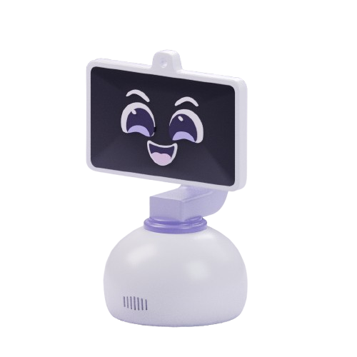
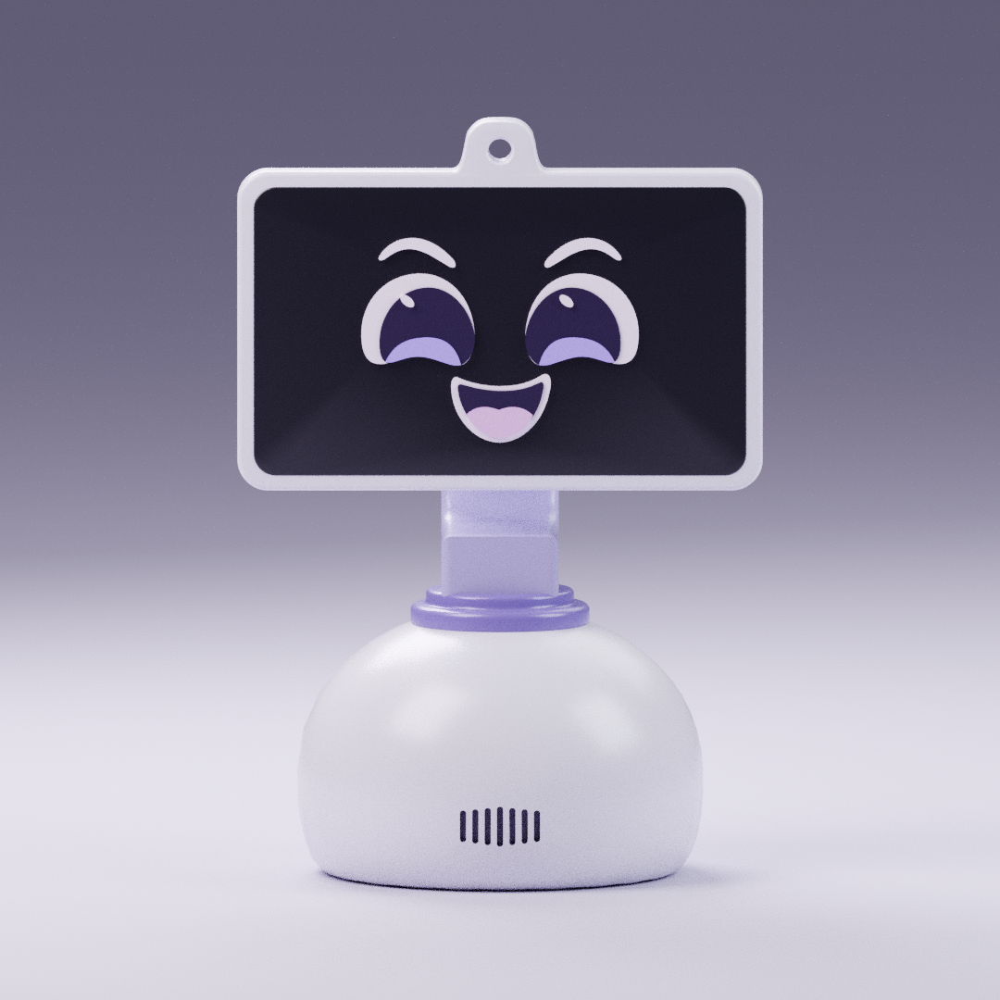
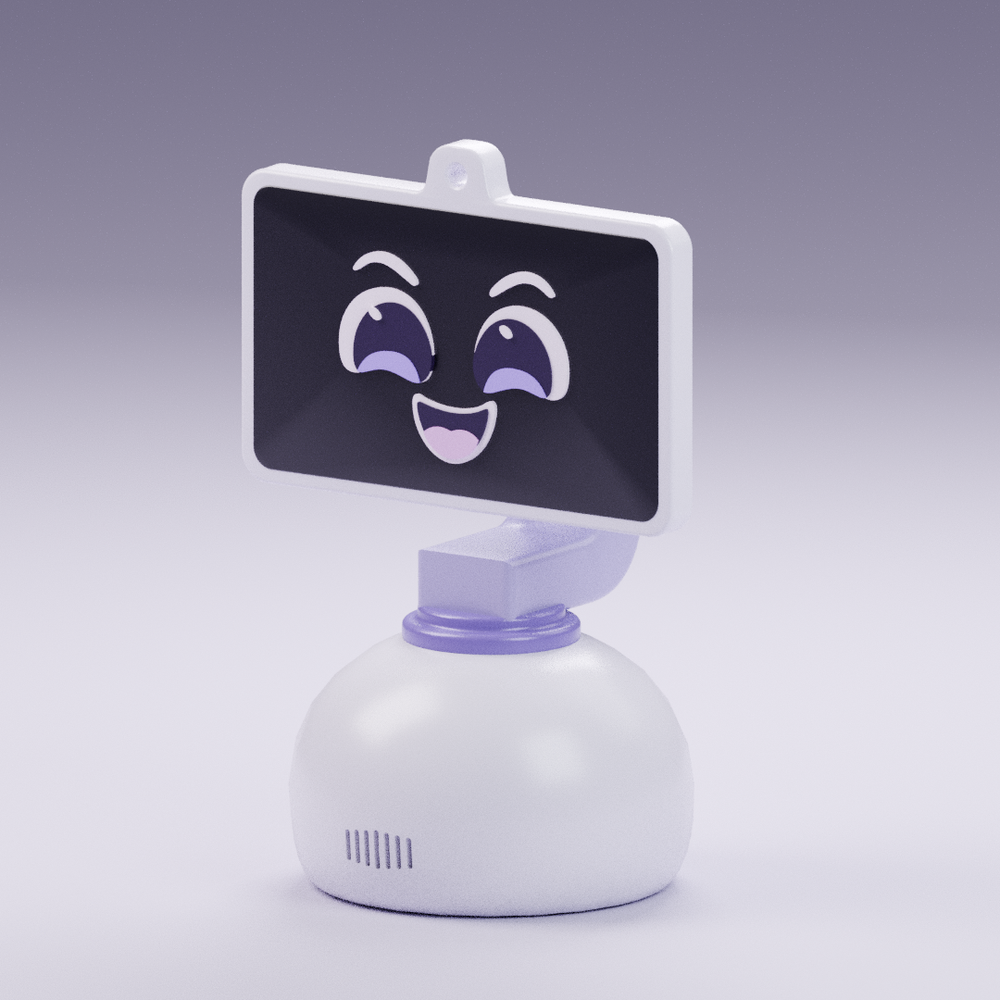
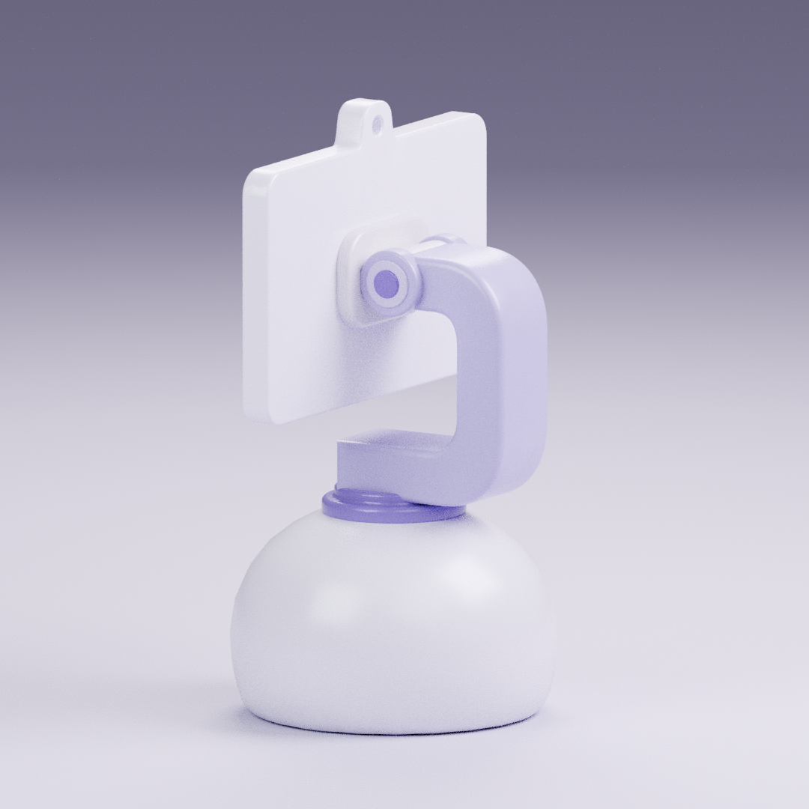

# MINI-ZIBO
This is a mini version of my actual desktop companion robot built for helping students with their studies.
I'm submitting this as a trinket which we'll be handed at Shenzhen, China.

This is a one-piece object which can be kept on the desk or even used as a keychain through the keyring hole at the top.
The CAD folder contains a .step and .3mf file for 3D printing.

Please preserve the colors provided in the attached files as closely as your printing equipment allows.
For the finish, standard is okay, but Matte is prefered if possible.

